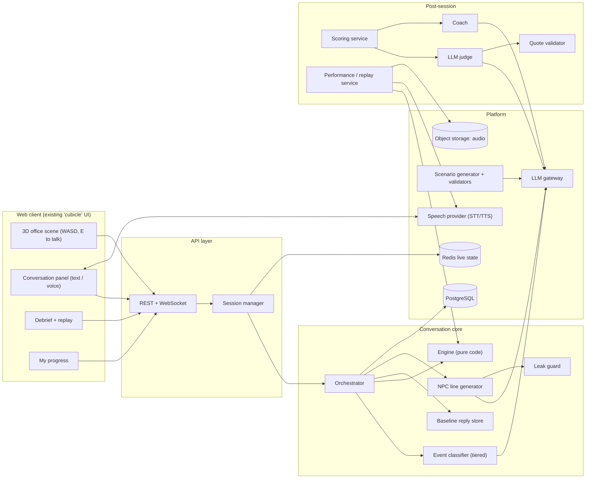

# ARCHITECTURE.md — System architecture

Version 0.1 · 2026-10-16 · Whole project. Items marked **[S1]** target the demo; **[S2]** target total implementation. The frontend remains vanilla JavaScript, Vite and Three.js. Engine/schema modules, provider-agnostic LLM/fallback modules, the Node API, guards, scoring, typed UI, debrief, and basic local progress exist with offline evidence; provider/live acceptance remains deferred. Architecture below is the target contract, not evidence that every module satisfies it.

## 1. Principles

1. **Engine decides, LLM speaks.** State changes, reveals, goals, endings, and scores are code (R-11).
2. **Sealed means absent.** A hidden fact is not in any prompt until revealed (R-01).
3. **Scene is a skin.** The engine is scene-agnostic; text-only works (D-11).
4. **Everything snapshotted.** Per-turn state snapshots enable rewind and corrected performances (D-13).
5. **Fail soft.** Every external call has a retry, a schema check, and a fallback (R-12).
6. **Config over code.** Scenarios, weights, replies, taxonomies are data.

## 2. System overview



**Demo (S1) simplification [D-18]:** in-memory session dict, JSON dump at session end; no Redis, Postgres, accounts, or object storage. `SessionStore` interface is defined now so the swap is mechanical.

## 3. Components

| Component | Responsibility | Stage |
|---|---|---|
| **Web client** | Vanilla JavaScript + Vite; Three.js office in `src/office.js`, typed SC-01 and scripted SC-02/03 in `src/main.js`, scored debrief and basic local progress; Lucide icons | S1 |
| **API layer** | HTTP + WebSocket; auth (S2); rate limits; never returns sealed data | S1 |
| **Session manager** | Create/restore/end sessions, customisation, locale, branching | S1 |
| **Orchestrator** | Runs the turn pipeline (§5) | S1 |
| **Event classifier** | Tiered: rules → small model → LLM fallback; outputs events | S1 (LLM), S2 (trained tier) |
| **Engine** | State, events → updates, mood, ledger, facts, goals, beats, acts | S1 |
| **Reply store** | Guarded fallback lines keyed by act + state (S1); normal first lookup (S2) | S1 (small), S2 (full) |
| **NPC generator** | Builds constrained prompt, calls LLM, 1–3 sentences | S1 |
| **Leak guard** | Keyword + semantic check, regenerate once, fallback | S1 |
| **Scoring service** | Metric registry; deterministic metrics; judge orchestration | S1 |
| **Judge / quote validator** | Rubric scoring with verified quotes | S1 |
| **Coach** | Corrected replies from flagged moments | S1 (one improved reply), S2 (all) |
| **Performance/replay service** | Redo branches; two-voice corrected performances | S2 |
| **LLM gateway** | Model routing, schema validation, retry/fallback, tracing, cost | S1 |
| **Speech provider** | STT/TTS behind an interface | S1 stretch, S2 |
| **Scenario generator** | JD/user text → spec → validators → playtest | S2 |
| **Progress/analytics** | Attempts, trends, dashboards | S1 basic, S2 |

## 4. Scenario spec (single JSON document, schema-validated)

```jsonc
{
  "id": "missed_deadline",
  "version": 1,
  "locales": ["en"],
  "title": "Missed a project deadline",
  "difficulty": "beginner",
  "duration_min": [3, 5],
  "briefing": { "en": "The project was due yesterday. Your manager is waiting for an update." },
  "player": { "name": "Alex", "role": "employee" },
  "clock": { "day": 0 },
  "canon": {
    "public": { "project_status": "unfinished", "original_due_day": -1 },
    "private": { "client_cutoff": { "day": 3, "owner": "maya", "fact_id": "F1" } }
  },
  "commitment_model": {
    "unassisted_min_day": 3,
    "assisted_min_day": 2,
    "assistance_requires": ["F2_delivered", "help_accepted_with_jordan"],
    "latest_day_from": "canon.private.client_cutoff.day",
    "agreement_npc": "maya"
  },
  "scene": { "layout": "everyday_office", "npc_positions": { "maya": "desk_a", "jordan": "desk_b", "sam": "sofa" } },
  "npcs": [
    { "id": "maya", "name": "Maya Chen", "role": "manager",
      "persona": "...", "public_context": "...", "default_sliders": {"assertiveness":50,"patience":50,"warmth":50,"forthcomingness":50} },
    { "id": "jordan", "name": "Jordan Lee", "role": "teammate", "persona": "...", "public_context": "..." },
    { "id": "sam", "name": "Sam Taylor", "role": "people_and_culture", "persona": "...", "public_context": "..." }
  ],
  "goals": [
    { "id": "G1", "visible": true, "required": true, "weight": 10, "label": "Own the delay with Maya",
      "done_when": "npc:maya AND event:took_ownership AND event:gave_honest_status", "requires": [] },
    { "id": "G2", "visible": true, "required": true, "weight": 10, "label": "Find out what's left with Jordan",
      "done_when": "npc:jordan AND event:asked_requirement_details", "requires": [] },
    { "id": "G3", "visible": true, "required": true, "weight": 10, "label": "Agree and confirm a next step",
      "done_when": "date_mutually_agreed AND event:recapped_agreement", "requires": ["G1","G2"] }
  ],
  "facts": [
    { "id": "F1", "owner": "maya", "weight": 8,
      "content": { "en": "Client's hard cutoff is Friday, 3 days away." },
      "triggers": ["asked_deadline_flexibility","asked_why_urgent","asked_impact"],
      "leak_keywords": { "en": ["friday","hard cutoff","three days","3 days"] },
      "unlock_question": { "en": "Is there any flexibility, and what happens if it slips?" } }
  ],
  "beats": [
    { "id": "B2", "npc": "maya", "when": "turn>=4 and no_commitment", "act": "press_for_date" },
    { "id": "B3", "npc": "maya", "when": "commitment_made and turns_since_commitment>=3", "act": "callback_commitment" }
  ],
  "end": { "max_turns": 20 },
  "scoring": { "version": 1, "weights": { "goals": 30, "hidden_facts": 20, "integrity": 15, "relationship": 10, "rubric": 25 } }
}
```

Rules: loaded and validated at startup; stored server-side; client receives only briefing, visible goals, NPC names/roles (R-08). This is a partial illustrative spec, not a complete playable fixture: F2/F3 and their canon are in `PRD.md` SC-01. D-27 confirms relative-day clock/model constants; the complete validated fixture is `/scenarios/missed_deadline.json`. See §6.5 for commitment semantics. Never pass complete private canon or model bounds to the NPC prompt.

## 5. Turn pipeline

```
POST /sessions/{id}/turn  { npc_id, text }
 1. Append user turn (U1, U2, …) to transcript.
 2. classify(text, last_turns, user_known_facts, clock) -> events    [S1: LLM; S2: tiered]
 3. engine.apply(state, npc_id, events)                              [CODE]
      - per-NPC mood update (slider-scaled)
      - commitment ledger update; relay accuracy check
      - fact probe counters; stage reveal if trigger + forthcomingness gate
      - goals + beats; end-condition check
      - choose dialogue act (priority list §6)
 4. reply = replyStore.fetch(npc, act, state, locale)                [CODE]
      miss -> prompt builder -> LLM (temp ~0.8, 1–3 sentences)
      S1 skips this lookup: LLM writes every act; store is failure fallback only (D-23).
 5. leak_guard(reply, sealed_facts_for_all_npcs)                     [CODE + semantic]
      hit -> regenerate once -> else baseline deflection
      Apply bounded keyword echo allowance and canon guard to every source (§10).
 6. Append guarded NPC turn (N1, N2, …); commit delivered outcomes; snapshot; trace.
 7. Return { npc_reply, public_state, ended, end_reason? }
```

**Public state** returned: mood label, visible goal statuses, next-step hint, NPC availability, `ended`. Nothing else (R-03).

**NPC prompt composition:** persona + slider tone text · public and NPC-accessible canon · that NPC's revealed facts and any single engine-authorised staged reveal for the selected act · what the user has told this NPC · CURRENT MOVE (act + one-line instruction) · recent turns with this NPC. Explicitly prohibit invention of deadlines, scope, progress, resources and agreement. Distinguish user assertions from verified canon. No other NPC's unrelayed facts, private bounds or sealed fact text. A staged reveal is authorised for generation only; discovery credit waits for delivery (§6.5).

## 6. Engine

### 6.1 State (serialisable, snapshotted per turn)
```
session: { id, scenario_id, scenario_version, locale, seed, customisation{npc→sliders}, clock, turn }
npcs[npc_id]: { mood, probes{fact_id→count}, told_by_user[turn_ids], last_act }
facts[fact_id]: sealed | probed | pending_delivery | revealed
user_known: [fact_ids]              # what the user has discovered
commitments: [{id, what, target_day, original_words, turn_id, npc_id, status, model_inputs, unrealistic, accepted_with, recap_turn_id, supersedes}]
goals[goal_id]: pending | done (turn_id)
beats[beat_id]: pending | fired
events_log: [{turn_id, npc_id, type, params}]
flags: [...]                        # derived by code for the timeline
```

### 6.2 Event taxonomy (language-neutral; extend, never free text)
Inquiry: `asked_deadline_flexibility`, `asked_why_urgent`, `asked_requirement_details`, `asked_background`, `asked_impact`, `asked_for_help`, `asked_advice`, `asked_expectation`
Commitment: `committed_deadline{days}`, `proposed_scope_cut`, `proposed_phased_delivery`, `proposed_plan`, `confirmed_next_steps`, `recapped_agreement`
Behaviour: `gave_honest_status`, `took_ownership`, `blamed_others`, `apologized`, `acknowledged_concern`, `pushed_back_constructively`, `avoided_question`
Communication: `relayed_fact{fact_id, accurate}`, `greeted`, `small_talk`, `off_topic`, `repeated_question`, `asked_reveal_all`

Classifier input: latest message + last 2 turns with this NPC + facts the user already knows + fixed scenario clock. Convert relative dates to whole-day offsets from day 0 (tomorrow → 1, Friday → 3 in SC-01); ambiguous/intraday dates produce a clarification need, not a rounded deadline. `confirmed_next_steps` may carry `help_accepted:true` when the user explicitly accepts the offered help with Jordan; code validates F2 delivery and NPC before activating assistance. The classifier interprets utterances, not realism or acceptance. `overpromised`, if retained for traces, is derived by the engine from the commitment model and is not accepted as classifier output. Relay accuracy is a proposed interpretation; validate the referenced known fact and supporting text before applying credit/penalty. Unsupported or uncertain relay judgments earn no credit or penalty.

Output: `{"events":[{"type":"…","params":{}}]}`; invalid → retry once → `{"events":[]}`. Event/parameter changes require schema validation, examples and scoring-version changes (R-27); the existing classifier validator and accepted `clarify` sidecar require audit in S1-03; module presence is not acceptance.

### 6.3 Mood and parameters (defaults; sliders scale them)

| Slider | Engine effect |
|---|---|
| Assertiveness | Higher → harsher B3 callback, `press_for_date` one turn earlier (turn 3 instead of 4), pushes back on scope cuts |
| Patience | Mood drop per `avoided_question`/`overpromised`/vague: patience 100 → −3, 50 → −8, 0 → −15. Walkout threshold: patience 0 → mood ≤ 25; patience 100 → mood ≤ 5 |
| Warmth | Start mood = 35 + warmth × 0.3. Gain on `apologized`/`took_ownership`/`acknowledged_concern`: +4 (low) → +10 (high) |
| Forthcomingness | Probing asks needed: ≥70 → 1 ask; 30–69 → 2 asks (1 if mood ≥ 60); <30 → 2 asks and mood ≥ 50 |

S1-12 applies one shared set of integer sliders (0–100, default 50) to all three colleagues. Missing keys default to 50; invalid objects, unknown keys and invalid values are rejected without coercion. They are fixed at session creation and copied into the ended debrief. Difficulty is display-only: the mean of assertiveness, 100−patience, 100−warmth and 100−forthcomingness is Easy below 34, Medium below 67, otherwise Hard (D-29); there is no score multiplier.

Server-side `llm/tone.js` maps the same values through `llm/prompts/npc/v3-tone.json` at bands below 30 / 30–69 / at least 70. NPC prompt version v3 composes the existing v2 move instructions with this v3 tone asset. Both live and offline manifests identify the new NPC composition; judge/coach and scoring versions are unchanged. Tone never authorizes a disclosure or selects an act. The client imports only public settings and preview wording, never the server tone asset, engine or scenario specification. Engine constants remain provisional and unchanged; live tone/guard acceptance is NOT RUN. Approved presets (D-32) are implemented by S1-13's optional setup selector.

### 6.4 Dialogue act selection (first match wins) — R-33
1. `walkout` if mood ≤ walkout threshold
2. `callback_commitment` if beat B3 is due for this NPC
3. `reveal_fact:<id>` if a trigger fired **and** the forthcomingness gate passed
4. `deflect_sealed` if the user probed a sealed fact and the gate did not pass
5. `redirect_to_npc` if the topic belongs to another NPC's knowledge area
6. `press_for_date` if beat B2 is due
7. `close_positive` if the NPC's closing condition is met
8. `acknowledge_relay` if the user relayed information this turn
9. `greet` on first contact
10. `react_freely` (default)

### 6.5 Goal and ending evaluation
`done_when` is a small expression language over `npc:<id>`, `event:<type>`, `fact_revealed:<id>`, `date_mutually_agreed`, `goal_done:<id>`. Required goals gate ending. Hidden goals are scored only.

**Credit sources.** Validate that all goal-completion event types and all fact-trigger event types are disjoint (R-22); `fact_revealed` must not award a second goal achievement credit. One turn may contain distinct events, each with its own source ID. Allocate achievement credit once per source, and exclude allocated goal/fact/integrity source events from relationship-score replay (§11.1).

**Commitments.** Fixed `clock` gives the day-0 reference; turns do not advance calendar time. An active commitment is **unrealistic** when its whole-day target is below the applicable minimum or above the cutoff in `commitment_model`. For the proposed SC-01 fixture, minimum day 3 becomes day 2 only after delivered F2 and explicit acceptance of help in Jordan's conversation; the cutoff remains day 3, privately owned by Maya through F1. No invented scope reduction or user claim changes those bounds. Unknown/ambiguous dates require clarification. Store model inputs with each evaluation; assistance changes can trigger a recorded reevaluation. Historical penalties remain tied to the original promise and are not repeatedly applied by callbacks.

`date_mutually_agreed` is code state for the current commitment ID: the engine accepts a realistic proposed date in Maya's conversation. G3 additionally requires G1/G2 and a recap of that same active ID. A revision supersedes the old ID and clears acceptance/recap; agreeing in NPC prose cannot set state. Record each callback once per relevant active commitment; if due while talking to another NPC, defer it to Maya without sharing Maya's hidden knowledge.

**Delivered outcomes.** An eligible reveal is staged only when its reveal act wins selection; do not expose suppressed reveals in prompt context. Authorise that owner's selected fact for generation and validation; all other sealed facts remain blocked. Verify the guarded reply actually expresses the authorised fact before committing it to the transcript for delivery, marking it revealed/user-known and awarding credit. Guard failure, fallback deflection or an interrupted commit earns no discovery credit and leaves the reveal pending for safe retry. Idempotent delivery retries never award again. Agreement/closing outcomes similarly commit only with their guarded transcript line. Debrief-only disclosure of missed facts never changes discovery credit or past snapshots.

## 7. Baseline reply store

Stage 1 uses this as the failure fallback for every act; Stage 2 uses the normal lookup below (D-23). Fallback lines pass both guards and cannot imply an undelivered reveal or agreement.

```
reply: { id, scenario_id, npc_id, act, guard (state predicates), tone_tags[], locale,
         variants[], slots[], cooldown_turns, source: authored|promoted, reviewed_by }
```

- **Lookup**: by `(scenario, npc, act, locale)`, filtered by guards (mood band, commitment made, facts revealed), then by tone tags matching the NPC's sliders; choose a variant outside the no-repeat window; fill slots (`{committed_date}`).
- **Never matches on user wording** (D-10). The classifier handles wording → events.
- **Typical store coverage:** greet, deflect_sealed, reveal_fact (fixed phrasing), press_for_date, close_positive, walkout, redirect_to_npc, error/clarify fallbacks.
- **Promotion**: reviewed LLM lines for common (act, state) combos can be promoted → higher hit rate over time.
- **Metrics**: hit rate per act, fallback rate, repeats.

## 8. LLM gateway

- Model routing: Groq adapter implemented behind the existing gateway (D-30). Defaults: classifier `openai/gpt-oss-20b`, NPC `qwen/qwen3.8-27b`, judge/coach `openai/gpt-oss-120b`. `LLM_PROVIDER=offline` remains default; live use requires both `LLM_PROVIDER=groq` and server-side `GROQ_API_KEY`.
- Structured output with JSON schema; retry once; fallbacks per R-12.
- Per-call trace: `{model, prompt_version, schema_version, tokens, latency, cost}`.
- Timeouts and circuit breaker: on provider outage, serve baseline replies and show a "retry" affordance.
- No user identity sent to providers (R-53).
- Groq: built-in fetch, 8-second HTTP deadline including response consumption, per-model token bucket (6,000 TPM default), process-wide conservative reserved-token/call budgets (60,000/40 default). Requests reserve `ceil(chars/4) + max_tokens` before dispatch; reservations are not refunded. Insufficient bucket capacity falls back immediately. A 429 waits for Retry-After capped at 20 seconds, then falls back without a second request. Gateway permits this bounded provider deadline; live turn safety ceiling is 180 seconds to cover validation retries and guarded regeneration. This ceiling is not a latency target or measured result.
- JSON object mode for supported models plus existing local schema checks. Per-role `*_REASONING_EFFORT`, `*_MAX_TOKENS`, and `*_EXTRA_PARAMS` configure supported options; unsupported reasoning values and extras are omitted. Supported extras are `top_p`, `seed`, `stop`; keys/routing cannot be overridden. Live NPC dialogue uses the exact locally validated `{text:string}` envelope, unwrapped before the existing dialogue guards. On documented compatible NPC models it requests strict `json_schema`; other roles, explicit schemas, and unknown models retain their existing JSON-object or omitted-format behavior. Malformed envelopes retry once then fall back; offline/fake provider interfaces remain unchanged.
- `RUN_LIVE=1 npm run llm:smoke` additionally requires configured Groq; sends classifier/NPC checks with at most three HTTP calls and prints sanitized latency/validation summaries. P2c saved-case runners also refuse without `RUN_LIVE=1`; they remain NOT RUN stubs, not acceptance harnesses. The [2026-10-17 bounded smoke](../evals/reports/groq-smoke-2026-10-17.json) used two HTTP calls: classifier 813 ms, NPC 197 ms, both JSON validated. Full live acceptance remains NOT RUN; these two calls do not establish classifier quality, guard safety or end-to-end latency compliance.

## 9. Event classifier tiers

The tier table is the Stage 2 target. Stage 1 uses the schema-validated LLM classifier directly (D-08); ordinary validation and engine arithmetic stay code.

| Tier | Method | When |
|---|---|---|
| 0 | Rules/keywords per locale (greeting, explicit questions about deadline/format, etc.) | Always first; cheap |
| 1 | Small trained classifier (embedding + head, SetFit-style or fine-tuned) **[S2]** | If tier 0 is inconclusive |
| 2 | LLM, temp 0, JSON | Low confidence or new phrasing |

Logged LLM labels + human review become training data for tier 1 (D-08). Confidence thresholds tuned against labelled sets; measured by recall on trigger events.

## 10. Leak guard

1. **Keyword scan** of the NPC reply against `leak_keywords` for **all** sealed facts (any NPC), normalised per locale, except the selected owner/act's engine-authorised pending disclosure. That exception is separate from echo allowance. Ignore only echo spans already in this NPC's user transcript, accessible revealed facts or its logged commitments. Echo is attribution, not confirmation: "you proposed Friday" can be safe while "yes, Friday is the client's cutoff" is not. No disclosure or score follows from an echo.
2. **Semantic check** using local/non-generative similarity and constrained claim validation for paraphrase leaks (English S1, multilingual S2). This remains to be implemented and evaluated; no extra generative validator role or provider is selected. Fail closed on uncertain material claims rather than treating keyword absence as proof of safety.
3. On hit: regenerate once with a generic correction instruction, never the sealed fact text; second hit → baseline `deflect_sealed`; log the event. Validate fallback too; use a prevalidated neutral clarification if no act-specific fallback passes. At most one shared guard regeneration per turn.
4. **Canon guard (R-09).** Validate factual claims and commitments against filtered public/NPC-accessible canon, the chosen act, known facts and active ledger. Reject invented/contradictory dates, progress, scope, resources or agreement. Internal validation may read server-side bounds, but those cannot be copied into prompts or responses while sealed. Echo allowance does not bypass this or the semantic check. Exact checks for structured dates/IDs plus constrained claim checks and acceptance tests are required; natural-language guards are not a proof of correctness.
5. Sealed prompt exclusion limits extraction; models can still guess facts. Test both untriggered disclosure and user guesses followed by confirmation. Stage authorised reveals separately from delivered discovery (§6.5), and include semantic checks for English in S1; multilingual expansion is S2.

## 11. Scoring and debrief

### 11.1 Metrics (plugin registry)
| Metric | Points | Method |
|---|---|---|
| Goals | 30 | Goal weights awarded on detected completion |
| Hidden facts | 20 | Fact weights for revealed facts |
| Integrity | 15 | Start 15; −8 per unrealistic commitment under §6.5; −4 contradicted commitment without explanation; −3 per validated inaccurate relay; floor 0. Apply once per distinct source; no extra `overpromised` penalty for the same commitment |
| Relationship | 10 | Replay mood from each configured starting mood using only events not allocated to goal/fact/integrity credit; normalise improvement as `10 × clamp((final − start)/(100 − start), 0, 1)`, averaged over scenario NPCs. Live mood still uses all eligible events |
| Rubric | 25 | LLM judge: quality only, 5 dimensions × 0–5 with verified quotes; no goal/fact achievement or commitment/relay correctness points already assessed by code; `insufficient` = 0 |

Weights, penalties, relationship mapping and bands are **provisional** (R-26); stored per scenario with `scoring_version`. Goals and fact triggers must be disjoint; maintain a source allocation ledger so the same source cannot earn achievement points twice (D-24). Judges may cite a turn also used by code only to assess quality, never to re-award achievement. Validate ≥85 smart-path and <50 trap-path targets using authored fixtures before treating the rubric as calibrated.

### 11.2 Flow
```
session end → deterministic metrics → judge (full transcript with turn IDs, events, rubric anchors)
→ quote validator → flags (code) → priorities (largest point loss) → coach (flagged moments only)
→ debrief record
```
Runs asynchronously; the UI polls or subscribes. Judge: temp 0, JSON, quality-only anchors (0 harmful/absent, 3 adequate, 5 exemplary, one observable example per dimension); never award points merely for completed goals or discovered facts (R-22). Coach input: flagged moments and transcript up to each moment; output `{what_happened, why_it_matters, better_reply}`; validator confirms the original line quotes.

### 11.3 Flags (code, from events)
`premature_commitment`, `missed_probe`, `constructive_pushback`, `broken_promise`, `great_recap`, `inaccurate_relay`, `ignored_npc_redirect` (extend as needed).

## 12. Replay, rewind, corrected performance **[S2]**

- **Redo from this moment**: copy session, restore snapshot at turn N−1, mark `branch_of`/`branch_turn`, continue with adaptive NPC. Original debrief stays intact.
- **Listen (performance)**: take `better_reply` → run through classifier + engine from the snapshot → NPC line via normal pipeline → produce a 2–4 turn script → TTS with a **user voice** and the **NPC voice**, cache audio by `hash(text, voice, locale)`, play with captions.
- Constraint: `better_reply` uses only information the user had (R-25). Performance runs are marked as *illustrative* and never alter the score.
- **S1 minimum**: debrief shows one improved response as text.

## 13. Voice **[S1 stretch → S2; D-35 Accepted]**

This is the approved implementation plan: no voice implementation, routes, flags, or scripts are shipped yet.

English only. Voice is off by default behind server `VOICE_ENABLED=1` and client `VITE_VOICE=1`; a user must explicitly enable it. Typed input remains permanently available.

```
push-to-talk → MediaRecorder → POST /sessions/{id}/voice/stt → editable transcript
→ confirmed text → existing normal turn pipeline → committed guarded NPC reply
→ speech descriptor → nonblocking server prefetch → id-scoped fetch → playback
```

- Server interface: `SpeechProvider.transcribe({audio, mime, signal}) → {text, duration_ms, provider}` and `SpeechProvider.synthesize({text, voice, signal}) → {audio: Buffer, mime, provider}`. The initial approved local sidecar uses faster-whisper `small.en` for STT and Piper by default for TTS; Kokoro is deferred unless the human asks. Cloud is a future adapter only and is not implemented by D-35.
- STT ends in an editable draft. Only user-confirmed text enters the normal turn, transcript, scoring, and quote-validation paths (R-21/R-23).
- TTS runs only after the guarded NPC line has committed, including a guarded fallback. It never delays the text response or alters engine state, disclosure credit, scoring, or visible text.
- The turn response may expose only `speech: { available: boolean, turn_id: string, mode: "server" | "browser" | "none" }`. It carries no text, labels, facts, voice identifiers, acts, or guard data.
- Audio is fetched only through private, session-and-id-scoped routes for an already committed NPC turn or stored guarded debrief reply. No route accepts client-provided synthesis text. Browser `SpeechRecognition` is not local STT; browser `speechSynthesis` is only a last-resort local TTS mode.
- Audio stays in memory only and is omitted from logs, snapshots, session dumps, progress summaries, and debug traces. It is dropped when the session ends or is deleted (R-54/R-66). Opaque session IDs are the only session identifier shared with a provider (R-53).
- S2 retains streaming STT, barge-in, language-matched voices, and the <2.5 s first-audio target.

## 14. Localisation **[S2]**

- Language-neutral: event labels, fact/goal/act IDs, state, scoring.
- Localised: scenario text, NPC persona/tone text, reply-store variants, UI strings, leak keywords, rubric anchors, unlock questions.
- Process per language: classifier examples (≥N per event) → labelled eval set → leak keyword list → reply variants → judge prompt check → fairness comparison vs English.
- **Quote validation** operates on the user's original-language turn; normalisation handles Unicode forms; Hinglish/transliteration needs tolerant matching (open decision O-04).
- Order: English → Hindi → Hinglish text → voice per language.

## 15. Scenario generation and community library **[S2]**

```
JD / user brief → generator LLM → spec JSON
 → JSON Schema validation
 → semantic validators:
     every fact has an owner, ≥1 trigger, leak keywords
     every trigger event exists in taxonomy
     goals achievable; dependencies acyclic
     weights sum correctly; no double-count
     content safety screen (R-43)
 → scripted-bot playtest (smart path, trap path, reveal-everything path)
 → author review/edit
 → private → (quality gates) → shared library
```
Promotion to the shared library requires: validation pass, review, minimum plays and rating, no reports. Scenarios are versioned; scores record `scenario_version`.

## 16. 3D scene integration

- Scene → API events: `interact{npc_id}` (E pressed near NPC), `leave{npc_id}` (ESC / walk away), optional `proximity{npc_id}`.
- API → Scene: NPC availability, current "next small step", goal changes, NPC mood label (drives subtle UI chip only).
- The scene holds no scoring logic and no sealed data. Layouts and NPC positions come from `scenario.scene`. **[S2]** NPC idle/walk behaviours, extra rooms, interactive objects (O-05).
- Verified renderer is Three.js in `src/office.js`, invoked by vanilla JavaScript in `src/main.js`; E/proximity invokes the current local button dialogue. API integration remains planned.

## 17. Data model (PostgreSQL, S2)

`users` · `orgs`, `cohorts`, `memberships` · `scenarios` (id, version, spec JSON, status, author, visibility) · `scenario_reviews` · `sessions` (customisation, locale, branch_of, branch_turn, status) · `turns` (turn_id, npc_id, speaker, text, locale, source: store/llm/user) · `events` · `snapshots` (state JSON per turn) · `facts_revealed` · `commitments` · `scores` (metric rows with evidence) · `debriefs` · `flags` · `reply_store` · `performances` (script + audio refs) · `attempts` / progress views · `consents` · `traces`.
Redis: live session state, rate limits. Object storage: cached TTS audio, optional opt-in recordings.

## 18. API surface

```
GET  /scenarios                           -> list (briefing, visible goals, difficulty)
GET  /scenarios/{id}                      -> briefing + visible goals (never sealed data)
POST /sessions                            {scenario_id, sliders?} -> {session_id, briefing, settings, difficulty, public_state}  # Stage 1; shared integer sliders only
POST /sessions/{id}/turn                  {npc_id, text | audio} -> {npc_reply, public_state, ended, end_reason?}
POST /sessions/{id}/scene-event           {type, npc_id}  -> {public_state}
POST /sessions/{id}/end                   -> {ok}          # triggers debrief generation
GET  /sessions/{id}/debrief               -> {score, breakdown, timeline, priorities, moments[], missed_facts[], customisation}
POST /sessions/{id}/rewind                {turn_id}        -> {new_session_id}                [S2]
POST /sessions/{id}/performances          {moment_id}      -> {script, audio_urls}            [S2]
GET  /progress                            -> attempts, trends                               [S1 basic / S2]
POST /scenarios/generate                  {brief | jd}     -> {draft_spec, validation_report} [S2]
POST /scenarios/{id}/publish              -> {status}                                         [S2]
WS   /sessions/{id}/stream                -> NPC text/audio streaming                         [S2]
```

## 19. Latency budget (typical improvised turn)

| Stage | Target |
|---|---|
| Network + API | ≤ 100 ms |
| Classifier (tier 0/1) | ≤ 50 ms; (tier 2 LLM) ≤ 600 ms |
| Engine + reply lookup | ≤ 30 ms |
| NPC LLM (first token / full 1–3 sentences) | ≤ 700 ms / ≤ 1.8 s |
| Leak guard | ≤ 50 ms (keyword); semantic ≤ 200 ms |
| **Total p50 / p95** | **S1: < 3.5 s / < 5 s** (D-23); **S2: < 2 s / < 3 s**, fixed-line p50 < 0.5 s |

Totals are targets, not measured guarantees; individual rows are typical-stage budgets, not additive percentile promises. Measure from submit through complete guarded reply delivery, including retries/fallbacks; report sample count, provider/model, warm/cold conditions and fallback rate. S1 levers: short outputs, prompt trimming and model routing; stored normal replies, trained tiers and streaming are S2. Provider/models are selected in D-28; live measurements remain deferred.

Voice timing is measured separately: STT duration, TTS time-to-first-byte and total, and speech-end to first-audio. Voice measurements never merge into the guarded text-turn p50/p95 above; D-35's local-primary decision is pending a demo-laptop result of about 1.5 s or less p50 for added STT plus TTS-first-byte latency and no measured scene stutter.

## 20. Observability and evaluation

- Per-turn trace (R-15) with a dev-only debug panel showing events, act, source, leak result, latency.
- Eval sets in `/evals`: event labels per language; reveal-on-paraphrase; leak/injection tests (≥5 runs per untriggered fact); judge consistency (repeat-judge variance); quote validator unit cases; latency runs.
- Scripted bots: smart path, trap path, reveal-everything path, repeated-question path, off-topic path.
- Dashboards (S2): hit rate, fallback rate, leak events, p95 latency, cost per session, judge variance.

## 21. Security and privacy

Keys server-side; opaque session IDs to providers; transcript/audio retention limits and deletion; consent for employer visibility; rate limiting and abuse protection on generation endpoints; moderation for community content. See `RULES.md` §F.

**Server-only includes file serving (R-08).** The current Vite development root is the repository root. A shared demo must serve only frontend assets (for example production `dist`, or an explicitly restricted frontend root), never expose `CONTEXT`, scenario specs, reply templates, prompts or private canon through development/static routes. Keeping files out of JavaScript imports is insufficient. Verify direct URL requests cannot retrieve those files before sharing; server configuration has not been changed in this documentation pass.

## 22. Deployment **[S2]**

Containerised API + worker (post-session jobs), managed PostgreSQL/Redis, object storage + CDN for audio and assets, static hosting for the web client, secrets manager, staging and production environments, CI running engine tests (no network) and lint; evals on demand.

## 23. Known unknowns (as of 2026-10-16)

Groq account-specific limits and hosting target; STT/TTS providers (voice disabled for this Stage 1 pass); content for SC-03; Hinglish scope; exact stack for the trained classifier. D-27 confirms SC-01 relative-day fixtures; D-28 selects Groq/models and Node built-in HTTP for the API. Real-model quality, guard coverage and latency remain unmeasured.

### S1-07 delivered agreement, relay and explicit End
The engine independently checks known-fact references against the current user turn using conservative SC-01 patterns; uncertain, unsupported or conflicting classifier judgments cause no relay credit/penalty. Accurate relays add no mood effect. Duplicate interpretations of the same turn/fact create at most one integrity allocation. No underlying fact is added to another NPC's prompt: the NPC receives only the user's attributed words.
Agreement and recap are staged in engine state and finalized by guarded `commitDelivery`; G3 and goals-complete ending wait for delivered closing. Snapshots are refreshed after delivery. `POST /sessions/{id}/end` is idempotent and rejects attempts while a turn is in flight. The terminal harness supports `/end` and `/npc` inside scripted runs. Scene End calls the same endpoint and displays a temporary debrief placeholder. Full live smart/trap runs remain NOT RUN.

S1-07 review hardening: NPC versioned move instructions are in llm/prompts/npc/v2-moves.json and manifests identify NPC prompt v2. Accepted plans and closing require explicit engine authorization and a checked positive line; higher-priority acts cannot commit those outcomes. A recap before G1/G2 is ignored and cannot later end a session on another NPC's turn. Negated or mixed relay claims are declined. Guard authorizations use only the current NPC's own revealed fact IDs; another NPC's discovery does not authorize confirmation. End responses are bound to the originating browser run and stale responses are ignored. Final-turn idempotency replay precedes ended rejection; ended and in-flight state are rechecked after request-body consumption.

The two authorized acceptance/closing moves deliberately mandate one exact single sentence in the v2 asset, matching the conservative positive-delivery check. Other moves retain the usual 1–3-sentence improvised dialogue. A paraphrase or additional sentence on these two moves is declined with the usual retry/fallback; broader natural-language acceptance requires separately tested validation.

### S1-08 deterministic scoring (accepted offline)
`scoring/score.js` is a pure server-side scorer over an owned session/conversation/scenario snapshot (`createScoreRecord`); it is not wired into the live-session API/UI. SC-01 scoring version 2 implements D-24/D-29 with unchanged 30/20/15/10/25 weights and 8/4/3 penalties in `scoring/config.js`. Scenario schema's scoring-version constant is now 2; scenario content version remains 1. Results carry the scoring version, weights, penalties, source ledger, excluded duplicate/allocation reasons, code flags and top two ledger losses. Rubric remains pending, zero awarded, maximum 25 reserved; no judge/coach calls.

Goals use completed code goals; facts require delivered/revealed state plus the first delivered snapshot, never debrief-only disclosure. Historical unrealistic faults remain tied to their original event even after assistance reevaluation. The integrity floor records applied and requested penalties separately. The narrow contradiction rule recognizes only a standalone unquoted “I never promised a delivery date.” denying the most recent earlier promise made to that same NPC; explained/mixed/quoted/uncertain forms and normal revisions are declined, not penalized. A distinct later denial has its own commitment-and-user-turn source and may cost four in addition to an earlier unrealistic-promise fault; repeated interpretation of that denial, overpromised aliases and callbacks cannot charge it again. This conservative English boundary is not general natural-language contradiction understanding.

Relationship replay uses all three scenario NPCs (D-29), configured starting mood and existing mood-delta functions. It excludes causal goal/fact/integrity supporting source events; repeated completed-goal event types are separately excluded as repeated achievements rather than mislabelled causal evidence; distinct unallocated events in the same user turn remain eligible. It does not replay callback-only mood changes. No rounding is applied. Timeline flags are code-derived; provisional `missed_probe` means the player spoke to a fact's owner at least once and never fired one of its trigger events. It introduces no penalty. `ignored_npc_redirect` means the next user turn stays with the same NPC after a redirect. Priorities sort ledger lost credit/applied penalties by loss, then turn/source for stable ties.

`turn_map` explicitly separates engine turn numbers from conversation user IDs (1,3,5...). For partial histories, mapping uses the recorded engineTurn when available, otherwise the session-turn minus available-user-count offset; older unavailable quotes have null user IDs. Synthetic fixtures demonstrate smart deterministic 60 (30 goals +15 facts +15 integrity +0 relationship) and trap 7 (0+0+7+0). These are not calibrated total scores or proof of the >=85/<50 final acceptance targets.

S1-08 source provenance: newly created commitment rows persist the engine event source_id. Historical rows without it are matched one-to-one to valid creation events by turn/NPC/day and consumed in recorded order. G3 evidence uses the active accepted commitment's delivered recap turn, never an earlier ignored recap. Integrity fault sources apply chronologically before the floor, with recorded event order breaking same-turn ties. Recap flags deduplicate commitment IDs. Per-goal 10/10/10 and per-fact 8/7/5 allocations are pinned alongside caps/penalties in scoring version2, so shifting allocations while keeping category totals requires a new scoring contract version.

### S1-09 feedback (accepted offline; integrated by S1-10)
`scoring/judge.js` calls the existing gateway at temperature0 with five exact quality dimensions: honest_status, ownership, recovery_planning, communication, collaboration_under_pushback. Judge prompt/schema are v2; coach prompt/schema are v2. These are initial uncalibrated anchors matching PRD, not new weights or a calibrated rubric. Dimension scores are nullable integers0..5; malformed shape/range/duplicate/missing dimension IDs share the gateway's existing retry-once budget. Code validates each awarded quote against its referenced user turn; invalid/NPC/unknown/empty evidence becomes insufficient/zero. Judge points (<=25) stay separate from deterministic points; merely achieved goals/facts/date correctness are explicitly excluded from quality reward. Judge receives transcript text and an already-scored ledger projection, never the complete scenario or sealed fact definitions. Transcript payloads are explicitly untrusted evidence, not instructions.

`scoring/quotes.js` normalizes Unicode compatibility, whitespace/case, curly quotes and dash variants, then checks a nonempty substring in a user turn. Partial-word substrings are accepted by this documented contract. Obvious personal labels in generated explanations/coaching are rejected; this small English check is a safeguard, not a general tone or semantic verifier.

`scoring/coach.js` selects the first code flag with an available nonempty verified user moment (the S1 one-improved-response minimum). All code flags remain separately available from deterministic scoring. Full all-moment coaching is later scope. Input ends at that user line and uses the latest snapshot STRICTLY BEFORE its engine turn; the following NPC disclosure is never historical knowledge for that same moment. Only already-known fact content enters the coaching payload. Quote, schema, tone, keyword and local semantic checks share at most two provider attempts total; a leak does not start another two-call retry loop. Every generated explanatory field and improved reply is checked against facts unknown at that moment. Fallback prefers the selected missed fact or an unknown fact owned by the moment's NPC; its authored unlocking question also passes the historical leak check, otherwise a generic question is used. No flags/empty history yields an explicit general starter tip with null quote/turn, never fabricated evidence. What went well is returned before moment-specific feedback.

All judge dimensions and coach outputs include a manifest reference and source/fallback status. Fake-provider fixtures use fake model names and explicitly disclaim live measurements. Missing providers, terminal budget errors, malformed data and rejected coaching degrade safely. The gateway's minimal validator now enforces union/null types, numeric bounds, item counts, string minimum lengths and disallowed extra properties; caller-specific unique-ID/leak checks run inside the same bounded retry loop. No dependency or additional live validator role.

Offline cases are in scoring/tests/feedback.test.js; synthetic output shapes in evals/fixtures/s1-09-synthetic-feedback.json. Live consistency (smart/trap5x), fairness pair probes and quote-integrity requests are saved in evals/cases/s1-09-feedback.NOTRUN.json. They remain NOT RUN because no live allowance remains. Prompt plumbing and quote validation passing offline does not prove quality-only judgment, fairness, calibration or real-model safety.

S1-09 boundary: both feedback modules return pending/unavailable with zero provider calls while a session is active. An ended empty transcript still receives the explicit general starter tip. The judge's v2 initial anchors each include a generic observable example without scenario secrets; organized/relevant wording is assessed without rewarding brevity. Judge and coach schema versions are2 in role config. Historical source fixtures stay unchanged; tests and synthetic feedback generation end cloned trap/partial records in memory via engine.endSession.

S1-09 review hardening: historical coaching also reuses canonCheck for material dates/resources/scope. Already-known authored fact spans and supported historical context are retained; unsupported claims degrade through the same shared retry/fallback. Three explicit neutral scope inquiries are permitted despite the underlying guard's broad scope-word check; other unrecognized material wording conservatively falls back. Authored fallback questions pass this check too. Generated substantive fields are trimmed-nonblank; improved replies require1–3 actual letter/number-bearing sentences. Judge explanations reject whitespace-only. Personal-label filtering uses the quote typography normalizer, including curly apostrophes. These checks remain conservative local safeguards rather than general factual/tone understanding.

Shared canon date validation enumerates all date occurrences (weekdays, day counts and tomorrow), applying existing authorization rules to each. A permitted known/authorized F1 date does not authorize a different date later in the same or another sentence. NPC and coaching callers share this behavior; their original authorized F1 reveal remains valid.

### S1-10 asynchronous debrief (accepted offline)
`scoring/debrief.js` snapshots an ended record, runs the accepted deterministic scorer and bounded judge/coach in parallel, defensively verifies displayed quote fields, and returns separate deterministic75/judged25 subtotals, total/band, timeline, top2loss priorities, historical coaching, missed facts/questions, settings, weights/version and manifest. Missing judge/coach use unavailable/fallback markers, never invented live scores. Partial totals/bands are explicitly provisional while the rubric is unavailable. Suggested bands remain85/70/50 without tuning. Missed-fact disclosure never mutates engine knowledge, points or earlier snapshots.

The API starts one shared asynchronous job on explicit End or automatic ending. GET /sessions/{id}/debrief is forbidden/not-ready before end and never returns missed facts then; after end it returns pending202 or ready/partial200. Polls and repeated End share the same immutable job snapshot. POST /sessions/{id}/debrief/retry permits at most one explicit retry after unavailable feedback; an in-flight retry is shared, ready feedback is not regenerated. Unexpected job failures fall back to deterministic results and authored coaching. Default offline manifests truthfully mark judge offline-unavailable and coach authored-fallback with prompt/schema v2; no fake rubric scores.

The frontend replaces the end placeholder with the incumbent scrollable modal. Server strings are escaped, positives precede fixes, quality evidence is expandable, and partial/provisional/unavailable states are explicit. Polling is bounded to60 checks with one-second waits and a manual Check feedback control afterward; it is bound to the original run/modal and ignores stale responses. Cached results survive refresh errors. No score arithmetic, scenario facts or scoring configuration enters the bundle until returned by the ended-only API. No new dependencies, live calls or S1-11 work.

S1-10 review hardening: an engine-ended session with an in-flight final turn returns pending without starting or disclosing a debrief; snapshot creation waits until final guarded response delivery settles. Missing goal/fact priorities are absence-at-end guidance with specific labels and no arbitrary user quote. Explicit feedback retry preserves successful prior judge/coach components and only regenerates unavailable components; GET retains prior results while pending. Unknown POST retry outcomes recover via GET polling without another automatic POST. The unchanged band thresholds/labels are stored in SC01 scoring config version2 and copied into the saved record.

S1-10 final UI refinement: table source labels use Code/Judge while the explicit deterministic/judged subtotals and raw data remain unchanged. Async debrief updates preserve the active control where possible and restore Close with preventScroll when a retry/check control is disabled or removed; restoration is bound to the current modal/run. Root verified this keyboard behavior, desktop and narrow rendering, and bounded offline retry. Implementation stops after S1-10 per user direction; live calibration remains NOT RUN.

### S1-11 retry and local progress (accepted offline/browser)
The client stores only sanitized attempt summaries in `cubicle-progress`: date, opaque session ID, scenario ID, server-reported total/band/scoring version, five server-reported metric values and provisional status. It continues to read legacy `workplay-progress` and completion entries without persisting arbitrary legacy fields. No transcript, quote, missed fact or debrief text enters browser storage. A retry creates a new default-settings SC-01 API session, with stale create responses rejected after restart/scenario change. Ended debriefs stay server-side by ID while the API process lives; after restart historical retrieval degrades to an explicit unavailable state while the summary survives. The progress comparison performs no client score arithmetic and labels cross-version/provisional comparisons. Offline/browser evidence is recorded in `evals/reports/S1-11-gate.md`; real-provider trap/smart isolation and comparison remains NOT RUN in `evals/cases/s1-11-retry-progress.NOTRUN.json`.

### S1-13 optional setup presets (accepted offline)

`shared/presets.js` contains the approved public shared vectors. The client exposes them only when Vite supplies `VITE_PRESETS=1`; the default build omits the selector. Presets copy values into the existing setup draft, remain editable and never mutate a running session or server contract.

### S1-14 built-demo serving (implemented; live acceptance deferred)
`npm run build` creates the frontend; `npm run demo` serves its immutable asset buffers and the existing API together at `http://127.0.0.1:4173` (PORT override supported). It binds loopback only and forces API debug off. Provider selection remains the existing explicit configuration, default offline; it neither reads a credential file nor authorizes live evaluation. The production client uses same-origin API paths, while development retains localhost:8787 and an explicit window override takes precedence.

`services/static.js` preloads only regular built files from a real, non-symlink dist root. It excludes symlinked files/directories, hidden path segments and private repository prefixes. Requests use exact preloaded URL keys, decode once, reject malformed encodings/backslashes/NUL/dot segments, and never join request paths to the filesystem. Unknown paths return 404 rather than the app shell. GET/HEAD preserve asset MIME, length and nosniff; unsupported static methods return 405. Known API routes keep priority and unknown API prefixes remain JSON 404. Missing dist fails startup with build instructions.

`npm run verify:offline` runs the existing offline suite, API suite and build/bundle scan sequentially, removing live-provider/key/debug environment variables from child processes and stopping on failure. Live eval entry points stay opt-in and are not invoked. The existing Restart scenario action clears the active attempt without deleting saved summaries; no new reset surface is introduced. Demo readiness still requires the deferred live matrix in S1-14-gate.md.

### NPC fallback diagnostics

An NPC gateway fallback bypasses generation regeneration and enters the existing guarded authored fallback path, so it cannot earn delivery, reveal, agreement, or closing credit. The API writes one internal terminal event for that executed fallback using only a validated public NPC id, a fixed failure category, and an optional validated HTTP status; no prompt, user text, provider body, headers, credentials, or private guard reason is logged or added to the public response.
