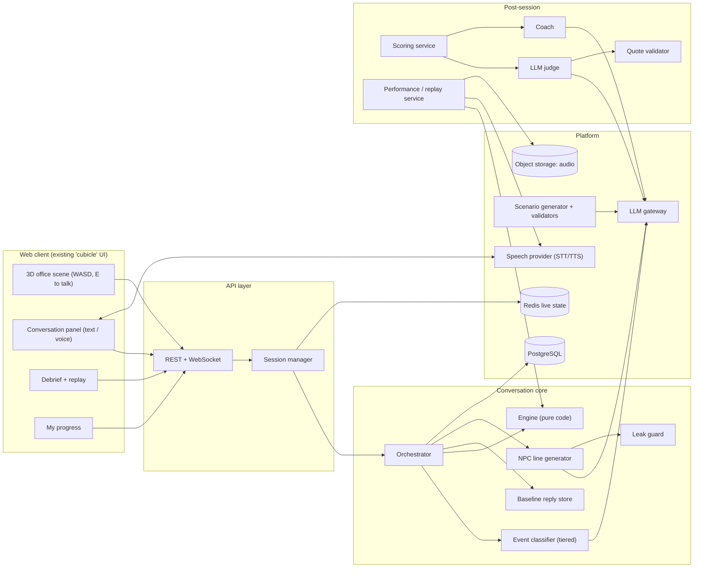

# ARCHITECTURE.md — System architecture

Version 0.1 · 2026-10-16 · Whole project. Items marked **[S1]** target the demo; **[S2]** target total implementation. The current build is frontend-only vanilla JavaScript, Vite and Three.js; API, engine and AI services below are planned, not implemented.

## 1. Principles

1. **Engine decides, LLM speaks.** State changes, reveals, goals, endings, and scores are code (R-11).
2. **Sealed means absent.** A hidden fact is not in any prompt until revealed (R-01).
3. **Scene is a skin.** The engine is scene-agnostic; text-only works (D-11).
4. **Everything snapshotted.** Per-turn state snapshots enable rewind and corrected performances (D-13).
5. **Fail soft.** Every external call has a retry, a schema check, and a fallback (R-12).
6. **Config over code.** Scenarios, weights, replies, taxonomies are data.

## 2. System overview



**Demo (S1) simplification [D-18]:** in-memory session dict, JSON dump at session end; no Redis, Postgres, accounts, or object storage. `SessionStore` interface is defined now so the swap is mechanical.

## 3. Components

| Component | Responsibility | Stage |
|---|---|---|
| **Web client** | Existing vanilla JavaScript + Vite; Three.js office in `src/office.js`, authored scenario/button dialogue and localStorage progress in `src/main.js`; Lucide icons. Free text, checklist, scored debrief and mood integration are planned | S1 |
| **API layer** | HTTP + WebSocket; auth (S2); rate limits; never returns sealed data | S1 |
| **Session manager** | Create/restore/end sessions, customisation, locale, branching | S1 |
| **Orchestrator** | Runs the turn pipeline (§5) | S1 |
| **Event classifier** | Tiered: rules → small model → LLM fallback; outputs events | S1 (LLM), S2 (trained tier) |
| **Engine** | State, events → updates, mood, ledger, facts, goals, beats, acts | S1 |
| **Reply store** | Guarded fallback lines keyed by act + state (S1); normal first lookup (S2) | S1 (small), S2 (full) |
| **NPC generator** | Builds constrained prompt, calls LLM, 1–3 sentences | S1 |
| **Leak guard** | Keyword + semantic check, regenerate once, fallback | S1 |
| **Scoring service** | Metric registry; deterministic metrics; judge orchestration | S1 |
| **Judge / quote validator** | Rubric scoring with verified quotes | S1 |
| **Coach** | Corrected replies from flagged moments | S1 (one improved reply), S2 (all) |
| **Performance/replay service** | Redo branches; two-voice corrected performances | S2 |
| **LLM gateway** | Model routing, schema validation, retry/fallback, tracing, cost | S1 |
| **Speech provider** | STT/TTS behind an interface | S1 stretch, S2 |
| **Scenario generator** | JD/user text → spec → validators → playtest | S2 |
| **Progress/analytics** | Attempts, trends, dashboards | S1 basic, S2 |

## 4. Scenario spec (single JSON document, schema-validated)

```jsonc
{
  "id": "missed_deadline",
  "version": 1,
  "locales": ["en"],
  "title": "Missed a project deadline",
  "difficulty": "beginner",
  "duration_min": [3, 5],
  "briefing": { "en": "The project was due yesterday. Your manager is waiting for an update." },
  "player": { "name": "Alex", "role": "employee" },
  "clock": { "date": "2026-10-13", "timezone": "Asia/Kolkata", "day": 0, "advance_on_turn": false },
  "canon": {
    "public": { "project_status": "unfinished", "original_due_day": -1 },
    "private": { "client_cutoff": { "day": 3, "owner": "maya", "fact_id": "F1" } }
  },
  "commitment_model": {
    "unassisted_min_day": 3,
    "assisted_min_day": 2,
    "assistance_requires": ["F2_delivered", "help_accepted_with_jordan"],
    "latest_day_from": "canon.private.client_cutoff.day",
    "agreement_npc": "maya"
  },
  "scene": { "layout": "everyday_office", "npc_positions": { "maya": "desk_a", "jordan": "desk_b", "sam": "sofa" } },
  "npcs": [
    { "id": "maya", "name": "Maya Chen", "role": "manager",
      "persona": "...", "public_context": "...", "default_sliders": {"assertiveness":50,"patience":50,"warmth":50,"forthcomingness":50} },
    { "id": "jordan", "name": "Jordan Lee", "role": "teammate", "persona": "...", "public_context": "..." },
    { "id": "sam", "name": "Sam Taylor", "role": "people_and_culture", "persona": "...", "public_context": "..." }
  ],
  "goals": [
    { "id": "G1", "visible": true, "required": true, "weight": 10, "label": "Own the delay with Maya",
      "done_when": "npc:maya AND event:took_ownership AND event:gave_honest_status", "requires": [] },
    { "id": "G2", "visible": true, "required": true, "weight": 10, "label": "Find out what's left with Jordan",
      "done_when": "npc:jordan AND event:asked_requirement_details", "requires": [] },
    { "id": "G3", "visible": true, "required": true, "weight": 10, "label": "Agree and confirm a next step",
      "done_when": "date_mutually_agreed AND event:recapped_agreement", "requires": ["G1","G2"] }
  ],
  "facts": [
    { "id": "F1", "owner": "maya", "weight": 8,
      "content": { "en": "Client's hard cutoff is Friday, 3 days away." },
      "triggers": ["asked_deadline_flexibility","asked_why_urgent","asked_impact"],
      "leak_keywords": { "en": ["friday","hard cutoff","three days","3 days"] },
      "unlock_question": { "en": "Is there any flexibility, and what happens if it slips?" } }
  ],
  "beats": [
    { "id": "B2", "npc": "maya", "when": "turn>=4 and no_commitment", "act": "press_for_date" },
    { "id": "B3", "npc": "maya", "when": "commitment_made and turns_since_commitment>=3", "act": "callback_commitment" }
  ],
  "end": { "max_turns": 20 },
  "scoring": { "version": 1, "weights": { "goals": 30, "hidden_facts": 20, "integrity": 15, "relationship": 10, "rubric": 25 } }
}
```

Rules: loaded and validated at startup; stored server-side; client receives only briefing, visible goals, NPC names/roles (R-08). This is a partial illustrative spec, not a complete playable fixture: F2/F3 and their canon are in `PRD.md` SC-01. Clock/model constants remain proposed pending P0.3. See §6.5 for commitment semantics. Never pass complete private canon or model bounds to the NPC prompt.

## 5. Turn pipeline

```
POST /sessions/{id}/turn  { npc_id, text }
 1. Append user turn (U1, U2, …) to transcript.
 2. classify(text, last_turns, user_known_facts, clock) -> events    [S1: LLM; S2: tiered]
 3. engine.apply(state, npc_id, events)                              [CODE]
      - per-NPC mood update (slider-scaled)
      - commitment ledger update; relay accuracy check
      - fact probe counters; stage reveal if trigger + forthcomingness gate
      - goals + beats; end-condition check
      - choose dialogue act (priority list §6)
 4. reply = replyStore.fetch(npc, act, state, locale)                [CODE]
      miss -> prompt builder -> LLM (temp ~0.8, 1–3 sentences)
      S1 skips this lookup: LLM writes every act; store is failure fallback only (D-23).
 5. leak_guard(reply, sealed_facts_for_all_npcs)                     [CODE + semantic]
      hit -> regenerate once -> else baseline deflection
      Apply bounded keyword echo allowance and canon guard to every source (§10).
 6. Append guarded NPC turn (N1, N2, …); commit delivered outcomes; snapshot; trace.
 7. Return { npc_reply, public_state, ended, end_reason? }
```

**Public state** returned: mood label, visible goal statuses, next-step hint, NPC availability, `ended`. Nothing else (R-03).

**NPC prompt composition:** persona + slider tone text · public and NPC-accessible canon · that NPC's revealed facts and any single engine-authorised staged reveal for the selected act · what the user has told this NPC · CURRENT MOVE (act + one-line instruction) · recent turns with this NPC. Explicitly prohibit invention of deadlines, scope, progress, resources and agreement. Distinguish user assertions from verified canon. No other NPC's unrelayed facts, private bounds or sealed fact text. A staged reveal is authorised for generation only; discovery credit waits for delivery (§6.5).

## 6. Engine

### 6.1 State (serialisable, snapshotted per turn)
```
session: { id, scenario_id, scenario_version, locale, seed, customisation{npc→sliders}, clock, turn }
npcs[npc_id]: { mood, probes{fact_id→count}, told_by_user[turn_ids], last_act }
facts[fact_id]: sealed | probed | pending_delivery | revealed
user_known: [fact_ids]              # what the user has discovered
commitments: [{id, what, target_day, original_words, turn_id, npc_id, status, model_inputs, unrealistic, accepted_with, recap_turn_id, supersedes}]
goals[goal_id]: pending | done (turn_id)
beats[beat_id]: pending | fired
events_log: [{turn_id, npc_id, type, params}]
flags: [...]                        # derived by code for the timeline
```

### 6.2 Event taxonomy (language-neutral; extend, never free text)
Inquiry: `asked_deadline_flexibility`, `asked_why_urgent`, `asked_requirement_details`, `asked_background`, `asked_impact`, `asked_for_help`, `asked_advice`, `asked_expectation`
Commitment: `committed_deadline{days}`, `proposed_scope_cut`, `proposed_phased_delivery`, `proposed_plan`, `confirmed_next_steps`, `recapped_agreement`
Behaviour: `gave_honest_status`, `took_ownership`, `blamed_others`, `apologized`, `acknowledged_concern`, `pushed_back_constructively`, `avoided_question`
Communication: `relayed_fact{fact_id, accurate}`, `greeted`, `small_talk`, `off_topic`, `repeated_question`, `asked_reveal_all`

Classifier input: latest message + last 2 turns with this NPC + facts the user already knows + fixed scenario clock. Convert relative dates to whole-day offsets from day 0 (tomorrow → 1, Friday → 3 in SC-01); ambiguous/intraday dates produce a clarification need, not a rounded deadline. `confirmed_next_steps` may carry `help_accepted:true` when the user explicitly accepts the offered help with Jordan; code validates F2 delivery and NPC before activating assistance. The classifier interprets utterances, not realism or acceptance. `overpromised`, if retained for traces, is derived by the engine from the commitment model and is not accepted as classifier output. Relay accuracy is a proposed interpretation; validate the referenced known fact and supporting text before applying credit/penalty. Unsupported or uncertain relay judgments earn no credit or penalty.

Output: `{"events":[{"type":"…","params":{}}]}`; invalid → retry once → `{"events":[]}`. Event/parameter changes require schema validation, examples and scoring-version changes (R-27); no new schema has been implemented yet.

### 6.3 Mood and parameters (defaults; sliders scale them)

| Slider | Engine effect |
|---|---|
| Assertiveness | Higher → harsher B3 callback, `press_for_date` one turn earlier (turn 3 instead of 4), pushes back on scope cuts |
| Patience | Mood drop per `avoided_question`/`overpromised`/vague: patience 100 → −3, 50 → −8, 0 → −15. Walkout threshold: patience 0 → mood ≤ 25; patience 100 → mood ≤ 5 |
| Warmth | Start mood = 35 + warmth × 0.3. Gain on `apologized`/`took_ownership`/`acknowledged_concern`: +4 (low) → +10 (high) |
| Forthcomingness | Probing asks needed: ≥70 → 1 ask; 30–69 → 2 asks (1 if mood ≥ 60); <30 → 2 asks and mood ≥ 50 |

Prompt tone text is generated from the same values (e.g. "clipped, sighs, short sentences" ↔ "calm, lets you finish"). Presets map to slider vectors (Supportive / Direct / Impatient). Difficulty label (Easy/Medium/Hard) is derived. Values are provisional; tune after playtests.

### 6.4 Dialogue act selection (first match wins) — R-33
1. `walkout` if mood ≤ walkout threshold
2. `callback_commitment` if beat B3 is due for this NPC
3. `reveal_fact:<id>` if a trigger fired **and** the forthcomingness gate passed
4. `deflect_sealed` if the user probed a sealed fact and the gate did not pass
5. `redirect_to_npc` if the topic belongs to another NPC's knowledge area
6. `press_for_date` if beat B2 is due
7. `close_positive` if the NPC's closing condition is met
8. `acknowledge_relay` if the user relayed information this turn
9. `greet` on first contact
10. `react_freely` (default)

### 6.5 Goal and ending evaluation
`done_when` is a small expression language over `npc:<id>`, `event:<type>`, `fact_revealed:<id>`, `date_mutually_agreed`, `goal_done:<id>`. Required goals gate ending. Hidden goals are scored only.

**Credit sources.** Validate that all goal-completion event types and all fact-trigger event types are disjoint (R-22); `fact_revealed` must not award a second goal achievement credit. One turn may contain distinct events, each with its own source ID. Allocate achievement credit once per source, and exclude allocated goal/fact/integrity source events from relationship-score replay (§11.1).

**Commitments.** Fixed `clock` gives the day-0 reference; turns do not advance calendar time. An active commitment is **unrealistic** when its whole-day target is below the applicable minimum or above the cutoff in `commitment_model`. For the proposed SC-01 fixture, minimum day 3 becomes day 2 only after delivered F2 and explicit acceptance of help in Jordan's conversation; the cutoff remains day 3, privately owned by Maya through F1. No invented scope reduction or user claim changes those bounds. Unknown/ambiguous dates require clarification. Store model inputs with each evaluation; assistance changes can trigger a recorded reevaluation. Historical penalties remain tied to the original promise and are not repeatedly applied by callbacks.

`date_mutually_agreed` is code state for the current commitment ID: the engine accepts a realistic proposed date in Maya's conversation. G3 additionally requires G1/G2 and a recap of that same active ID. A revision supersedes the old ID and clears acceptance/recap; agreeing in NPC prose cannot set state. Record each callback once per relevant active commitment; if due while talking to another NPC, defer it to Maya without sharing Maya's hidden knowledge.

**Delivered outcomes.** An eligible reveal is staged only when its reveal act wins selection; do not expose suppressed reveals in prompt context. Authorise that owner's selected fact for generation and validation; all other sealed facts remain blocked. Verify the guarded reply actually expresses the authorised fact before committing it to the transcript for delivery, marking it revealed/user-known and awarding credit. Guard failure, fallback deflection or an interrupted commit earns no discovery credit and leaves the reveal pending for safe retry. Idempotent delivery retries never award again. Agreement/closing outcomes similarly commit only with their guarded transcript line. Debrief-only disclosure of missed facts never changes discovery credit or past snapshots.

## 7. Baseline reply store

Stage 1 uses this as the failure fallback for every act; Stage 2 uses the normal lookup below (D-23). Fallback lines pass both guards and cannot imply an undelivered reveal or agreement.

```
reply: { id, scenario_id, npc_id, act, guard (state predicates), tone_tags[], locale,
         variants[], slots[], cooldown_turns, source: authored|promoted, reviewed_by }
```

- **Lookup**: by `(scenario, npc, act, locale)`, filtered by guards (mood band, commitment made, facts revealed), then by tone tags matching the NPC's sliders; choose a variant outside the no-repeat window; fill slots (`{committed_date}`).
- **Never matches on user wording** (D-10). The classifier handles wording → events.
- **Typical store coverage:** greet, deflect_sealed, reveal_fact (fixed phrasing), press_for_date, close_positive, walkout, redirect_to_npc, error/clarify fallbacks.
- **Promotion**: reviewed LLM lines for common (act, state) combos can be promoted → higher hit rate over time.
- **Metrics**: hit rate per act, fallback rate, repeats.

## 8. LLM gateway

- Model routing: small/fast model for classifier fallback; stronger model for NPC lines, judge, coach, generator. **Providers/keys unconfirmed (O-06).**
- Structured output with JSON schema; retry once; fallbacks per R-12.
- Per-call trace: `{model, prompt_version, schema_version, tokens, latency, cost}`.
- Timeouts and circuit breaker: on provider outage, serve baseline replies and show a "retry" affordance.
- No user identity sent to providers (R-53).

## 9. Event classifier tiers

The tier table is the Stage 2 target. Stage 1 uses the schema-validated LLM classifier directly (D-08); ordinary validation and engine arithmetic stay code.

| Tier | Method | When |
|---|---|---|
| 0 | Rules/keywords per locale (greeting, explicit questions about deadline/format, etc.) | Always first; cheap |
| 1 | Small trained classifier (embedding + head, SetFit-style or fine-tuned) **[S2]** | If tier 0 is inconclusive |
| 2 | LLM, temp 0, JSON | Low confidence or new phrasing |

Logged LLM labels + human review become training data for tier 1 (D-08). Confidence thresholds tuned against labelled sets; measured by recall on trigger events.

## 10. Leak guard

1. **Keyword scan** of the NPC reply against `leak_keywords` for **all** sealed facts (any NPC), normalised per locale, except the selected owner/act's engine-authorised pending disclosure. That exception is separate from echo allowance. Ignore only echo spans already in this NPC's user transcript, accessible revealed facts or its logged commitments. Echo is attribution, not confirmation: "you proposed Friday" can be safe while "yes, Friday is the client's cutoff" is not. No disclosure or score follows from an echo.
2. **Semantic check** using local/non-generative similarity and constrained claim validation for paraphrase leaks (English S1, multilingual S2). This remains to be implemented and evaluated; no extra generative validator role or provider is selected. Fail closed on uncertain material claims rather than treating keyword absence as proof of safety.
3. On hit: regenerate once with a generic correction instruction, never the sealed fact text; second hit → baseline `deflect_sealed`; log the event. Validate fallback too; use a prevalidated neutral clarification if no act-specific fallback passes. At most one shared guard regeneration per turn.
4. **Canon guard (R-09).** Validate factual claims and commitments against filtered public/NPC-accessible canon, the chosen act, known facts and active ledger. Reject invented/contradictory dates, progress, scope, resources or agreement. Internal validation may read server-side bounds, but those cannot be copied into prompts or responses while sealed. Echo allowance does not bypass this or the semantic check. Exact checks for structured dates/IDs plus constrained claim checks and acceptance tests are required; natural-language guards are not a proof of correctness.
5. Sealed prompt exclusion limits extraction; models can still guess facts. Test both untriggered disclosure and user guesses followed by confirmation. Stage authorised reveals separately from delivered discovery (§6.5), and include semantic checks for English in S1; multilingual expansion is S2.

## 11. Scoring and debrief

### 11.1 Metrics (plugin registry)
| Metric | Points | Method |
|---|---|---|
| Goals | 30 | Goal weights awarded on detected completion |
| Hidden facts | 20 | Fact weights for revealed facts |
| Integrity | 15 | Start 15; −8 per unrealistic commitment under §6.5; −4 contradicted commitment without explanation; −3 per validated inaccurate relay; floor 0. Apply once per distinct source; no extra `overpromised` penalty for the same commitment |
| Relationship | 10 | Replay mood from each configured starting mood using only events not allocated to goal/fact/integrity credit; normalise improvement as `10 × clamp((final − start)/(100 − start), 0, 1)`, averaged over scenario NPCs. Live mood still uses all eligible events |
| Rubric | 25 | LLM judge: quality only, 5 dimensions × 0–5 with verified quotes; no goal/fact achievement or commitment/relay correctness points already assessed by code; `insufficient` = 0 |

Weights, penalties, relationship mapping and bands are **provisional** (R-26); stored per scenario with `scoring_version`. Goals and fact triggers must be disjoint; maintain a source allocation ledger so the same source cannot earn achievement points twice (D-24). Judges may cite a turn also used by code only to assess quality, never to re-award achievement. Validate ≥85 smart-path and <50 trap-path targets using authored fixtures before treating the rubric as calibrated.

### 11.2 Flow
```
session end → deterministic metrics → judge (full transcript with turn IDs, events, rubric anchors)
→ quote validator → flags (code) → priorities (largest point loss) → coach (flagged moments only)
→ debrief record
```
Runs asynchronously; the UI polls or subscribes. Judge: temp 0, JSON, quality-only anchors (0 harmful/absent, 3 adequate, 5 exemplary, one observable example per dimension); never award points merely for completed goals or discovered facts (R-22). Coach input: flagged moments and transcript up to each moment; output `{what_happened, why_it_matters, better_reply}`; validator confirms the original line quotes.

### 11.3 Flags (code, from events)
`premature_commitment`, `missed_probe`, `constructive_pushback`, `broken_promise`, `great_recap`, `inaccurate_relay`, `ignored_npc_redirect` (extend as needed).

## 12. Replay, rewind, corrected performance **[S2]**

- **Redo from this moment**: copy session, restore snapshot at turn N−1, mark `branch_of`/`branch_turn`, continue with adaptive NPC. Original debrief stays intact.
- **Listen (performance)**: take `better_reply` → run through classifier + engine from the snapshot → NPC line via normal pipeline → produce a 2–4 turn script → TTS with a **user voice** and the **NPC voice**, cache audio by `hash(text, voice, locale)`, play with captions.
- Constraint: `better_reply` uses only information the user had (R-25). Performance runs are marked as *illustrative* and never alter the score.
- **S1 minimum**: debrief shows one improved response as text.

## 13. Voice **[S1 stretch → S2]**

```
Mic → (push-to-talk) → STT → editable transcript → normal turn pipeline
NPC text → TTS (per-NPC voice, locale) → audio stream → player (mutable)
```
- `SpeechProvider` interface: `transcribe(audio, locale)`, `synthesize(text, voice, locale)`. Providers are swappable; none are validated yet.
- S1: push-to-talk, user edits transcript before sending (R-42). TTS optional.
- S2: streaming STT, per-NPC voices, barge-in, audio cache, latency target < 2.5 s to first audio.
- Scoring uses the confirmed text only (R-23). Audio not retained by default (R-54).

## 14. Localisation **[S2]**

- Language-neutral: event labels, fact/goal/act IDs, state, scoring.
- Localised: scenario text, NPC persona/tone text, reply-store variants, UI strings, leak keywords, rubric anchors, unlock questions.
- Process per language: classifier examples (≥N per event) → labelled eval set → leak keyword list → reply variants → judge prompt check → fairness comparison vs English.
- **Quote validation** operates on the user's original-language turn; normalisation handles Unicode forms; Hinglish/transliteration needs tolerant matching (open decision O-04).
- Order: English → Hindi → Hinglish text → voice per language.

## 15. Scenario generation and community library **[S2]**

```
JD / user brief → generator LLM → spec JSON
 → JSON Schema validation
 → semantic validators:
     every fact has an owner, ≥1 trigger, leak keywords
     every trigger event exists in taxonomy
     goals achievable; dependencies acyclic
     weights sum correctly; no double-count
     content safety screen (R-43)
 → scripted-bot playtest (smart path, trap path, reveal-everything path)
 → author review/edit
 → private → (quality gates) → shared library
```
Promotion to the shared library requires: validation pass, review, minimum plays and rating, no reports. Scenarios are versioned; scores record `scenario_version`.

## 16. 3D scene integration

- Scene → API events: `interact{npc_id}` (E pressed near NPC), `leave{npc_id}` (ESC / walk away), optional `proximity{npc_id}`.
- API → Scene: NPC availability, current "next small step", goal changes, NPC mood label (drives subtle UI chip only).
- The scene holds no scoring logic and no sealed data. Layouts and NPC positions come from `scenario.scene`. **[S2]** NPC idle/walk behaviours, extra rooms, interactive objects (O-05).
- Verified renderer is Three.js in `src/office.js`, invoked by vanilla JavaScript in `src/main.js`; E/proximity invokes the current local button dialogue. API integration remains planned.

## 17. Data model (PostgreSQL, S2)

`users` · `orgs`, `cohorts`, `memberships` · `scenarios` (id, version, spec JSON, status, author, visibility) · `scenario_reviews` · `sessions` (customisation, locale, branch_of, branch_turn, status) · `turns` (turn_id, npc_id, speaker, text, locale, source: store/llm/user) · `events` · `snapshots` (state JSON per turn) · `facts_revealed` · `commitments` · `scores` (metric rows with evidence) · `debriefs` · `flags` · `reply_store` · `performances` (script + audio refs) · `attempts` / progress views · `consents` · `traces`.
Redis: live session state, rate limits. Object storage: cached TTS audio, optional opt-in recordings.

## 18. API surface

```
GET  /scenarios                           -> list (briefing, visible goals, difficulty)
GET  /scenarios/{id}                      -> briefing + visible goals (never sealed data)
POST /sessions                            {scenario_id, customisation, locale} -> {session_id, briefing, public_state}
POST /sessions/{id}/turn                  {npc_id, text | audio} -> {npc_reply, public_state, ended, end_reason?}
POST /sessions/{id}/scene-event           {type, npc_id}  -> {public_state}
POST /sessions/{id}/end                   -> {ok}          # triggers debrief generation
GET  /sessions/{id}/debrief               -> {score, breakdown, timeline, priorities, moments[], missed_facts[], customisation}
POST /sessions/{id}/rewind                {turn_id}        -> {new_session_id}                [S2]
POST /sessions/{id}/performances          {moment_id}      -> {script, audio_urls}            [S2]
GET  /progress                            -> attempts, trends                               [S1 basic / S2]
POST /scenarios/generate                  {brief | jd}     -> {draft_spec, validation_report} [S2]
POST /scenarios/{id}/publish              -> {status}                                         [S2]
WS   /sessions/{id}/stream                -> NPC text/audio streaming                         [S2]
```

## 19. Latency budget (typical improvised turn)

| Stage | Target |
|---|---|
| Network + API | ≤ 100 ms |
| Classifier (tier 0/1) | ≤ 50 ms; (tier 2 LLM) ≤ 600 ms |
| Engine + reply lookup | ≤ 30 ms |
| NPC LLM (first token / full 1–3 sentences) | ≤ 700 ms / ≤ 1.8 s |
| Leak guard | ≤ 50 ms (keyword); semantic ≤ 200 ms |
| **Total p50 / p95** | **S1: < 3.5 s / < 5 s** (D-23); **S2: < 2 s / < 3 s**, fixed-line p50 < 0.5 s |

Totals are targets, not measured guarantees; individual rows are typical-stage budgets, not additive percentile promises. Measure from submit through complete guarded reply delivery, including retries/fallbacks; report sample count, provider/model, warm/cold conditions and fallback rate. S1 levers: short outputs, prompt trimming and model routing; stored normal replies, trained tiers and streaming are S2. Provider/model selection remains open.

## 20. Observability and evaluation

- Per-turn trace (R-15) with a dev-only debug panel showing events, act, source, leak result, latency.
- Eval sets in `/evals`: event labels per language; reveal-on-paraphrase; leak/injection tests (≥5 runs per untriggered fact); judge consistency (repeat-judge variance); quote validator unit cases; latency runs.
- Scripted bots: smart path, trap path, reveal-everything path, repeated-question path, off-topic path.
- Dashboards (S2): hit rate, fallback rate, leak events, p95 latency, cost per session, judge variance.

## 21. Security and privacy

Keys server-side; opaque session IDs to providers; transcript/audio retention limits and deletion; consent for employer visibility; rate limiting and abuse protection on generation endpoints; moderation for community content. See `RULES.md` §F.

**Server-only includes file serving (R-08).** The current Vite development root is the repository root. A shared demo must serve only frontend assets (for example production `dist`, or an explicitly restricted frontend root), never expose `CONTEXT`, scenario specs, reply templates, prompts or private canon through development/static routes. Keeping files out of JavaScript imports is insufficient. Verify direct URL requests cannot retrieve those files before sharing; server configuration has not been changed in this documentation pass.

## 22. Deployment **[S2]**

Containerised API + worker (post-session jobs), managed PostgreSQL/Redis, object storage + CDN for audio and assets, static hosting for the web client, secrets manager, staging and production environments, CI running engine tests (no network) and lint; evals on demand.

## 23. Known unknowns (as of 2026-10-16)

LLM/STT/TTS providers and budget; API/engine implementation stack and hosting target; final SC-01 content/commitment fixtures; content for SC-03; Hinglish scope; exact stack for the trained classifier. Frontend stack is verified above.
